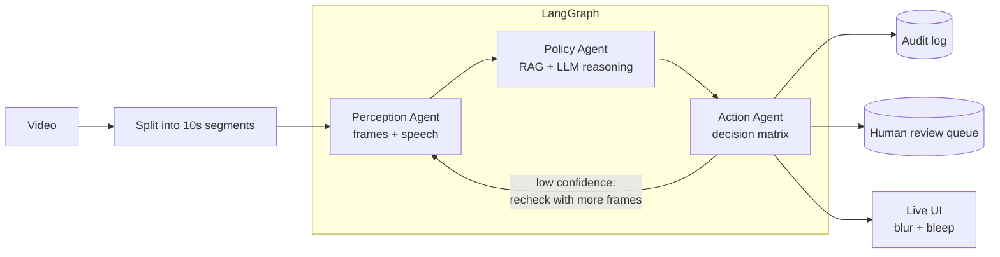

# Sentinel — Agentic Multimodal Video Moderation

Sentinel watches a video the way a human moderator would: it looks at the frames, listens to the audio, checks both against a written policy rulebook, and decides what to do — auto-takedown, send to a human, log it, or let it through. Every decision comes with a policy citation and an explanation, is written to an audit log, and is shown live in a web UI that blurs flagged frames and bleeps flagged words during playback.

It is built as three cooperating agents (Perception → Policy → Action) wired together with **LangGraph**, with a feedback loop that sends uncertain segments back for a closer look. All model inference runs on **Groq**, so it needs no GPU.

## Why multimodal?

Most moderation systems check images and speech separately. That misses the cases that matter most:

- A calm, ordinary-looking video where someone **says** a credible threat — the visuals look safe, the audio isn't.
- A news report that **shows** violence but frames it as journalism — the visuals look bad, the context makes it acceptable.

Sentinel's Policy agent reasons over **both** modalities together using explicit *interplay rules* from the rulebook:

| Rule | Situation | Outcome |
|---|---|---|
| INTERPLAY_01 | Neutral visual + harmful audio | Judged at full severity — a benign picture doesn't excuse the words |
| INTERPLAY_02 | Harmful visual + neutral audio | Judged on the visual — silence doesn't excuse the image |
| INTERPLAY_03 | Audio frames the visual as news / education / fiction | Severity drops one tier (never for real graphic violence or credible threats) |
| INTERPLAY_04 | Clear satire, not endorsement | MEDIUM/LOW drop one tier; HIGH is never downgraded |

## How it works



**1. Perception agent** — *what is seen and heard*
- Detects scene cuts (PySceneDetect) and samples one frame per distinct shot, instead of blindly sampling every N seconds.
- Each frame gets one vision-model call that returns a description **and** a yes/no "concerning" flag, so the UI knows exactly which frames to blur.
- The full audio is transcribed once with Whisper (word-level timestamps) and sliced per segment.

**2. Policy agent** — *does this break a rule?*
- Retrieves the most relevant policies from the rulebook with RAG (MiniLM embeddings in ChromaDB). It queries the audio and visual separately so a long visual description can't drown out a short spoken threat.
- Sends the retrieved policies, the fixed severity tiers and interplay rules, and the perception output to `gpt-oss-120b`.
- Returns structured JSON: policy ID, severity, confidence, which interplay rule applied, reasoning, the exact violating phrase, and whether the violation is visual, audio, or both.

**3. Action agent** — *what do we do about it?*

| Severity | Confidence | Action | Human review | Recheck |
|---|---|---|---|---|
| HIGH | ≥ 0.75 | `AUTO_TAKEDOWN` | — | — |
| HIGH | < 0.75 | `URGENT_HUMAN_REVIEW` | ✓ | ✓ |
| MEDIUM | ≥ 0.70 | `HUMAN_REVIEW` | ✓ | — |
| MEDIUM | < 0.70 | `LOW_PRIORITY_REVIEW` | ✓ | ✓ |
| LOW | any | `LOG_ONLY` | — | — |
| NONE | any | `PASS` | — | — |

When a verdict is serious but uncertain, the graph loops back to Perception, which samples more frames (6 instead of 4) for a closer look. This happens at most twice per segment.

## The live UI

Open the app, pick a clip (or upload one), and press start. Results stream in segment by segment over Server-Sent Events:

- **Agent pipeline view** that steps through Perception → Policy → Action as each segment result arrives.
- **Timeline** of segments coloured by severity, with the policy, reasoning and transcript for each.
- **Enforced playback**: flagged frames are blurred and the exact violating words are bleeped — only those moments, not the whole segment.
- **Human-in-the-loop queue**: segments routed for review can be confirmed, approved, or escalated by a moderator.
- **Metrics**: per-segment latency, rechecks, Groq API calls and token usage.

## Tech stack

| Part | Technology |
|---|---|
| Agent orchestration | LangGraph |
| Policy reasoning | `openai/gpt-oss-120b` on Groq |
| Frame understanding | `qwen/qwen3.8-27b` (vision) on Groq |
| Speech-to-text | `whisper-large-v3` on Groq, word timestamps |
| Policy retrieval | ChromaDB + `all-MiniLM-L6-v2` (runs locally on CPU/MPS) |
| Scene detection | PySceneDetect + OpenCV |
| Backend | FastAPI, Server-Sent Events |
| Frontend | Single-page React UI (`sentinel_live.html`), no build step |

## Getting started

**Requirements:** Python 3.11, [`uv`](https://docs.astral.sh/uv/), `ffmpeg`, and a free [Groq API key](https://console.groq.com/keys).

```bash
git clone https://github.com/Jitin18/sentinel-video-moderation.git
cd sentinel-video-moderation

brew install ffmpeg          # or your OS's package manager
cp .env.example .env         # then paste your GROQ_API_KEY into .env

./run.sh                     # first run creates .venv and installs dependencies
```

Open **http://127.0.0.1:9000**. Put any `.mp4` / `.mov` / `.avi` / `.mkv` files in `demo_clips/` to see them in the clip list, or upload one from the UI. Video files are not included in the repo.

### Command-line usage

Run the agents without the UI, from the `agents/` folder:

```bash
cd agents
../.venv/bin/python orchestrator.py ../demo_clips/your_clip.mp4   # full pipeline on a video
../.venv/bin/python policy_agent.py                               # two built-in text test cases
../.venv/bin/python action_agent.py                               # decision-matrix test
../.venv/bin/python rag_engine.py                                 # retrieval test, no API key needed
```

### Configuration

All settings live in `.env`. Model names can be overridden if Groq renames or retires one:

```bash
GROQ_API_KEY=gsk_...
# GROQ_POLICY_MODEL=openai/gpt-oss-120b
# GROQ_VISION_MODEL=qwen/qwen3.8-27b
# GROQ_WHISPER_MODEL=whisper-large-v3
```

Rate-limit (429) and connection errors from Groq are retried automatically with backoff.

### Customising the rules

The whole policy rulebook is [`guidelines/moderation_guidelines.md`](guidelines/moderation_guidelines.md): 15 policies across hate speech, violence, harassment, adult content, dangerous acts, misinformation and profanity/spam, plus the severity tiers, interplay rules and decision matrix. Edit it and restart — the RAG index is rebuilt at startup.

## API

| Method | Endpoint | Description |
|---|---|---|
| `GET` | `/` | The live UI |
| `GET` | `/clips` | Videos available in `demo_clips/` and uploads |
| `POST` | `/upload` | Upload a video |
| `GET` | `/stream?video_path=...&segment_len=10` | Moderate a video, streaming one SSE event per segment |
| `POST` | `/moderate` | Moderate a video and return the full result in one response |
| `GET` | `/video?path=...` | Serve a video file to the player |
| `GET` | `/gpu` | Groq API call and token counters (used as the "online" indicator) |
| `GET` | `/health` | Health check |

## Outputs

Every segment decision is appended to `logs/audit_log.jsonl` (timestamp, segment, policy, severity, confidence, action, reasoning, interplay rule). Segments that need a human are also appended to `logs/review_queue.jsonl`. Both files are git-ignored.

## Project structure

```
.
├── agents/
│   ├── orchestrator.py      # LangGraph graph: Perception → Policy → Action + recheck loop
│   ├── perception_agent.py  # scene-aware frame sampling, vision calls, transcription
│   ├── scene_detect.py      # shot-boundary detection with an even-spacing fallback
│   ├── policy_agent.py      # RAG-grounded verdicts from gpt-oss-120b
│   ├── rag_engine.py        # chunks, embeds and retrieves policies (ChromaDB)
│   ├── action_agent.py      # decision matrix, audit log, review queue
│   ├── groq_client.py       # Groq wrapper: chat, vision, Whisper, retries, usage stats
│   └── config.py            # paths and model names
├── guidelines/
│   └── moderation_guidelines.md   # the policy rulebook
├── demo_clips/              # your local test videos (not committed)
├── logs/                    # audit and review logs, written at runtime
├── backend.py               # FastAPI server
├── sentinel_live.html       # live moderation UI
├── run.sh                   # one-command setup and launch
└── requirements.txt
```

## Limitations

- Frames are sampled per scene, not analysed continuously, so a very brief violation between samples can be missed.
- Verdicts come from an LLM and can be wrong; the confidence thresholds and human review queue exist for that reason. This is a research/demo project, not a production moderation system.
- Speed depends on Groq rate limits. Long videos make many API calls (one vision call per sampled frame, one policy call per segment).
- Human review decisions in the UI are kept in the browser session and are not saved back to the server.

## License

Released under the [MIT License](LICENSE).
